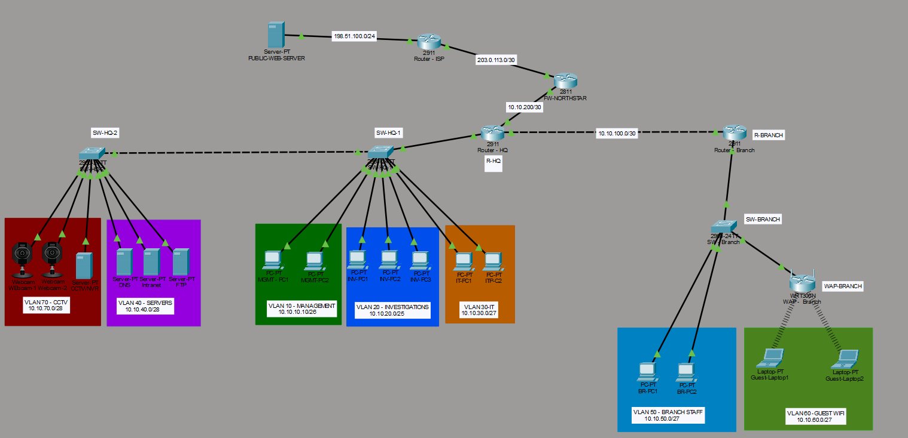

# Northstar Secure Corporate Network

A Cisco Packet Tracer portfolio project demonstrating the design, segmentation, routing, access control, perimeter security, centralized services, and validation of a small multi-site corporate network.

The fictional organization, **Northstar Investigations Ltd.**, consists of a headquarters, a branch office, and a simulated Internet environment.



## Project Overview

The network was built in two stages:

- **Static Addressing** – endpoint addressing is configured manually.
- **Centralized DHCP** – user endpoints receive addressing from a central DHCP server at HQ using DHCP relay.

Both versions use the same core segmented architecture and OSPF-based routing.

## Network Design

The environment includes seven VLANs:

| VLAN | Purpose | Subnet |
|---|---|---|
| 10 | Management | `10.10.10.0/26` |
| 20 | Investigations | `10.10.20.0/25` |
| 30 | IT | `10.10.30.0/27` |
| 40 | Servers | `10.10.40.0/28` |
| 50 | Branch Staff | `10.10.50.0/27` |
| 60 | Guest Wi-Fi | `10.10.60.0/27` |
| 70 | CCTV / Security | `10.10.70.0/28` |

HQ uses router-on-a-stick inter-VLAN routing. The branch has separate Staff and Guest VLANs and connects to HQ over a routed point-to-point link.

## Key Technologies

- VLAN segmentation and 802.1Q trunking
- Router-on-a-stick
- VLSM addressing
- OSPF dynamic routing
- Centralized DHCP and DHCP relay
- Extended and standard ACLs
- Cisco IOS Zone-Based Firewall (ZBF)
- PAT / NAT overload
- Restricted SSH management
- DNS, HTTP and FTP services
- Guest Wi-Fi isolation
- CCTV/security network isolation
- Simulated public Internet services

## Security Design

The lab applies several layers of access control rather than relying on a single perimeter mechanism.

**Investigations VLAN:** access to internal server resources is restricted to required services such as DNS, HTTP/HTTPS and FTP, while access to other protected internal VLANs is denied.

**Guest Wi-Fi:** guest clients can obtain centralized DHCP leases and reach permitted external services, but cannot directly access corporate VLANs.

**CCTV / Security:** cameras and the simulated NVR are isolated from initiating arbitrary routed connections. Management and IT can access the NVR where required.

**Perimeter:** an IOS Zone-Based Firewall separates the internal network from the simulated ISP. PAT provides address translation for approved user VLANs, while the Servers and CCTV VLANs are intentionally excluded from general Internet PAT.

**Management plane:** SSH is used for remote administration, with management access restricted by ACLs where implemented.

## Routing

OSPF provides dynamic routing between HQ and the branch.

R-HQ advertises the HQ VLANs and originates the default route toward the branch. User-facing interfaces are passive, while the HQ-to-Branch transit link forms the OSPF adjacency.

The perimeter firewall uses static routing between the internal network and the simulated ISP.

## Centralized DHCP Version

The second Packet Tracer version moves user endpoints from static addressing to centralized DHCP.

The DHCP service runs on the server at `10.10.40.2`. R-HQ relays requests for VLANs 10, 20 and 30, while R-BRANCH relays requests for VLANs 50 and 60.

Infrastructure devices, servers, switch management interfaces, the wireless access point and CCTV devices remain statically addressed.

This stage also demonstrates an important ACL interaction: initial DHCP Discover traffic uses `0.0.0.0:68`, so ACLs protecting client VLANs require an explicit DHCP bootstrap exception.

## Simulated Services

The server VLAN provides:

- DNS – `10.10.40.2`
- Internal web server – `10.10.40.3`
- FTP server – `10.10.40.4`

The CCTV VLAN contains a simulated NVR at `10.10.70.4`.

A public web server at `198.51.100.10` represents an Internet-hosted service and is used to validate PAT and firewall behavior.

## Validation

The completed lab was tested for:

- inter-VLAN and inter-site routing
- OSPF adjacency and route propagation
- centralized DHCP across routed networks
- internal DNS resolution
- permitted and denied ACL traffic
- Guest VLAN isolation
- CCTV isolation
- authorized and unauthorized SSH management
- PAT from multiple internal VLANs
- stateful HTTP/HTTPS inspection through the Zone-Based Firewall
- blocking of unsolicited external-to-internal traffic

Detailed implementation, troubleshooting and validation evidence is available in the technical documentation.

## Design Evolution

The original perimeter design used a Packet Tracer ASA 5506-X. During testing, the simulated ASA behavior did not provide a satisfactory scalable implementation for the required return traffic in this topology.

The perimeter was therefore rebuilt using a Cisco IOS Zone-Based Firewall. This became part of the project's troubleshooting and design process rather than being hidden from the final documentation.

## Repository Structure

```text
Northstar-Secure-Corporate-Network/
├── README.md
├── network-topology.png
├── Northstar_Static-Addressing.pkt
├── Northstar_Centralized-DHCP.pkt
├── Northstar_Technical_Documentation.pdf
└── Northstar_Command_Reference.txt
```

## Documentation

For the full design rationale, addressing plan, security policies, implementation details, troubleshooting history and validation results, see:

**`Northstar_Technical_Documentation.pdf`**

A concise configuration reference is also included:

**`Northstar_Command_Reference.txt`**

## Lab Notes

This project was created for learning and portfolio purposes in Cisco Packet Tracer.

Credentials such as `password123` are intentionally simplified lab credentials and must not be interpreted as production security practice.

The public-facing address ranges used in the simulation are documentation/test ranges.

## Author

**Norbert Willmann**  
Cybersecurity portfolio project – 2026
